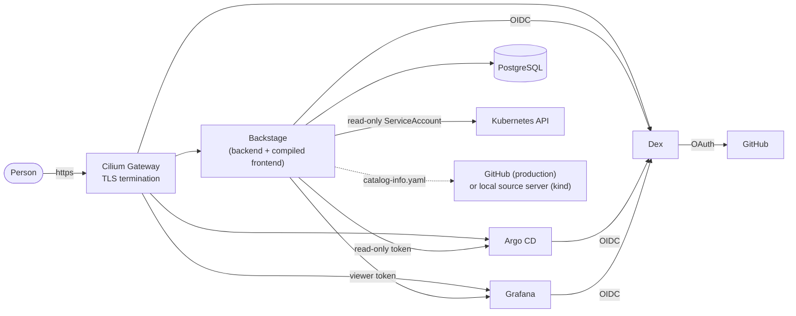

# Architecture

## The pieces

Backstage is a single process: the **backend** (Node) serves the API and the compiled **frontend**, so the browser talks to one origin
and there is no CORS to configure. It keeps its state in PostgreSQL. Everything it shows about the cluster it reads with
**its own** credentials, never with a person's: people prove who they are to Backstage through Dex, and Backstage reads Kubernetes,
Argo CD and Grafana with dedicated read-only identities. The portal can therefore show a lot and change nothing.

## Read-only on purpose

| System | Identity the portal uses | What it can do |
|---|---|---|
| Kubernetes | ServiceAccount `backstage` + ClusterRole `backstage-read` | `get`, `list`, `watch` on workloads, Argo CD Applications, policy reports, Kyverno policies, Cilium and Gateway objects. No Secrets, no `exec`, no logs |
| Argo CD | local account `backstage` (API key), role `portal` | read Applications and Projects |
| Grafana | service account `backstage`, role Viewer | list dashboards, read alerts |
| GitHub | token or GitHub App (production only) | read repositories and the organisation's members and teams |

The ClusterRole is in `platform-demo-helm/backstage/templates/rbac.yaml`; the Argo CD and Grafana accounts are created by
`kind/sso-bootstrap.sh`, and their tokens live only in the `backstage-secrets` Secret.

## Configuration layers

The image contains four configuration files; which ones are loaded is decided by the chart (`config.files`).

| File | Purpose | Loaded |
|---|---|---|
| `app-config.yaml` | Everything that is the same everywhere: plugins, Kubernetes, Argo CD, Grafana, TechDocs, the catalog rules | always |
| `app-config.production.yaml` | PostgreSQL, Dex single sign-on, publish directory | in the image |
| `app-config.github.yaml` | Catalog discovery and users/teams from the GitHub organisation | production |
| `app-config.kind.yaml` | Catalog read from the local source server (no GitHub) | the local cluster |

Every environment-specific value is an environment variable with a sensible default; the chart's ConfigMap and Secret provide them.

## What was deliberately left out

| Left out | Why |
|---|---|
| Software templates (scaffolder) | Nothing can be pushed yet, and creating repositories needs GitHub permissions that the free plan makes awkward. Adding it later is a backend module and one frontend package |
| Notifications and signals | Nobody sends any |
| Permissions framework policy | The portal is read-only and everyone who may sign in may see everything: `allow-all`. The Kyverno plugin's permission checks are off |
| The Home page | The catalog is the landing page; a Home page of widgets would be decoration |
