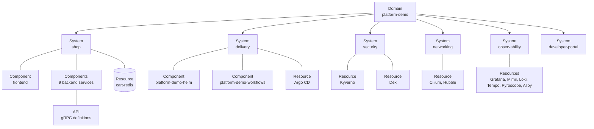

# Catalog

The catalog is **built from the repositories**, not typed in by hand: every repository carries a `catalog-info.yaml` that says what
it is, who owns it, what it depends on and where its live state can be found. Backstage reads those files and joins them.

## The model

| Kind | Used for | Where it is defined |
|---|---|---|
| **Domain** | The whole project | `catalog/platform.yaml` in this repository |
| **System** | A group that is useful to look at together (shop, delivery, security, networking, observability, developer portal) | `catalog/platform.yaml` |
| **Component** | Something with a repository: the eleven `app-*` repositories, the Helm repository, the shared workflows, the observability stack, the docs, the organisation profile, this portal | Each repository's `catalog-info.yaml` |
| **API** | The gRPC interface of a service, with its `.proto` rendered in the API tab | The service's `catalog-info.yaml`, `$text` includes the proto |
| **Resource** | Infrastructure without a repository of its own: the cluster, Argo CD, Kyverno, Dex, Cilium, Hubble, Grafana and its backends, Redis, the registry | `catalog/platform.yaml` |
| **Group / User** | The organisation and its people | GitHub (production) or `catalog/org.yaml` (local demo) |

Components point at their owner (`group:default/maintainers`), their system, what they `dependsOn` and which APIs they provide and
consume, so the graph answers "what breaks if `product-catalog-service` is down" without anyone drawing it.

## The annotations that make the plugins work

A component only shows a plugin's tab when it carries the annotation that plugin reads.

| Annotation | Read by | Meaning |
|---|---|---|
| `backstage.io/techdocs-ref: dir:.` | TechDocs | The entity has documentation. With the external builder this is only the marker |
| `backstage.io/kubernetes-label-selector` | Kubernetes, Kyverno | Which objects belong to the entity: `app.kubernetes.io/name=<service>` matches its Deployment, Service, Pods and every other object the charts label |
| `backstage.io/kubernetes-namespace` | Kubernetes | Where to look |
| `backstage.io/kubernetes-id` | Kubernetes | Kyverno's mutation `pd-backstage-kubernetes-id` copies the name into this label on every workload pod, so it also works as a selector |
| `argocd/app-name: dev-<service>` | Argo CD | The Application that deploys it |
| `grafana/dashboard-selector: tags @> '<tag>'` | Grafana | Dashboards of the service (each dashboard carries its service's tag) |
| `grafana/overview-dashboard` | Grafana | A dashboard shown embedded on the entity page |
| `grafana/alert-label-selector` | Grafana | Which firing alerts belong to the entity (`service=<name>`) |
| `github.com/project-slug` | GitHub links | `platform-boutique/<repo>` |

## Adding a repository

1. Add `catalog-info.yaml` at the root (copy one from a service of the same kind). Give it the annotations above that apply.
2. For documentation add `mkdocs.yml` and a `docs/` folder (see [Documentation](techdocs.md)).
3. Production: nothing else, the next discovery run (15 minutes) finds it. Local demo: add the path to `app-config.kind.yaml`, run `kind/local-source.sh sync`.
4. If the thing runs in the cluster, add it to `envs/dev/workloads.yaml` and `policies/values.yaml` in the Helm repository as usual.

## Where the catalog comes from

| Environment | Source | How |
|---|---|---|
| Production | The GitHub organisation | `catalog.providers.github` scans every repository for `/catalog-info.yaml` every 15 minutes; `githubOrg` imports teams as groups and members as users (named after their GitHub login) |
| Local cluster | A small HTTP server on the host | `kind/local-source.sh` serves a staging copy of each descriptor (and the `.proto` files they include) because nothing is pushed. Shared entities and demo users are baked into the image |
