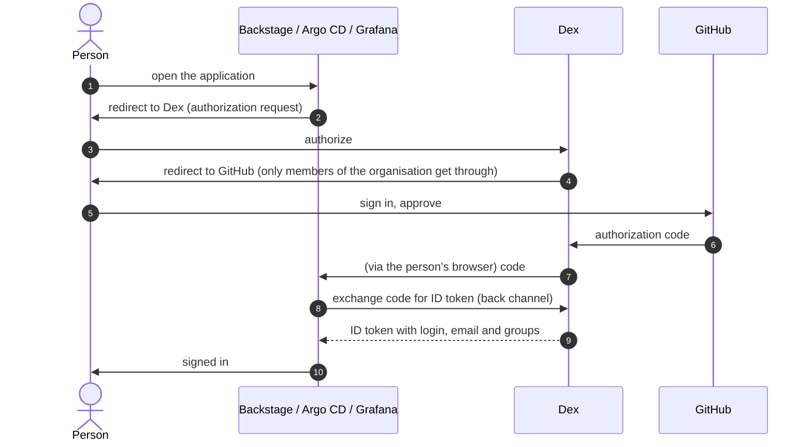

# Single sign-on

One identity provider, three applications. **Dex** speaks OpenID Connect to Backstage, Argo CD and Grafana and, behind it,
signs people in with their GitHub account.

## Why Dex

| Option | Verdict |
|---|---|
| **Dex + GitHub** | Free, open source, ~30 MB. One provider for all three applications, GitHub teams arrive as groups. Chosen |
| Keycloak | A full identity provider with its own user database. Heavier (0.7-1 GB here) and a second set of users to keep in sync with the organisation |
| GitHub in each application | No central provider; Argo CD would still need its bundled Dex. Three configurations to keep consistent |

GitHub itself is not an OIDC provider (it speaks OAuth 2), which is exactly the gap Dex closes.

## Who gets what

| Application | How a person is mapped | Group effect |
|---|---|---|
| Backstage | `preferred_username` (the GitHub login) becomes `user:default/<login>`; email is the fallback. People who are not in the catalog cannot sign in | Ownership comes from the catalog (`memberOf`) |
| Argo CD | The groups claim | `platform-boutique:maintainers` is `role:admin`; everybody else is `role:readonly` |
| Grafana | The groups claim | `platform-boutique:maintainers` get Admin; everybody else Viewer |

Everybody signs in with a GitHub account. There is no local or static user.

## The issuer URL

`https://dex.platform-demo.click` is the issuer for browsers **and** for the pods. The AWS load balancer terminates TLS with a public
ACM certificate and the Cilium Gateway forwards plain HTTP to the Dex Service, so pods resolve and trust the issuer like any public
site: no DNS rewrite and no private CA are needed. (The load balancer only admits the configured source addresses; the NAT gateways'
addresses are among them so that Argo CD and Backstage can reach the issuer from inside the cluster.) This is the design; it has not been verified on EKS yet.

## Going live with GitHub

!!! warning "Needs you"
    Registering an OAuth App can only be done in the GitHub web UI. Nothing of this has been exercised on EKS yet.

1. In the organisation: **Settings → Developer settings → OAuth Apps → New**. Homepage `https://backstage.platform-demo.click`,
   callback URL `https://dex.platform-demo.click/callback`.
2. Put the client id and secret into SSM Parameter Store as `/platform-demo/github-oauth/client-id` and `/client-secret`
   (`SecureString`). External Secrets Operator turns them into the `dex-secrets` Secret; the other secrets are listed in
   `docs/secrets.md` of `platform-demo-helm`.
3. Create the GitHub team `maintainers` in the organisation and add people. Its slug becomes the group `platform-boutique:maintainers`.
4. Catalog discovery (`app-config.github.yaml`, already in `config.files` of `envs/dev/values/backstage.yaml`) needs a GitHub token (or,
   better, a GitHub App) in SSM as `/platform-demo/github/token`; it ends up in `GITHUB_TOKEN` of `backstage-secrets`.

## What is not covered

| Thing | Why |
|---|---|
| Hubble UI | It has no authentication at all; the way to give it a login is a reverse proxy (`oauth2-proxy`) in front of it. The plan is to replace it with a Backstage view rather than to wrap it |
| Prometheus-style endpoints and gRPC services | Not user interfaces |
| Logging out everywhere | Each application has its own session. Signing out of one does not sign you out of the others |
